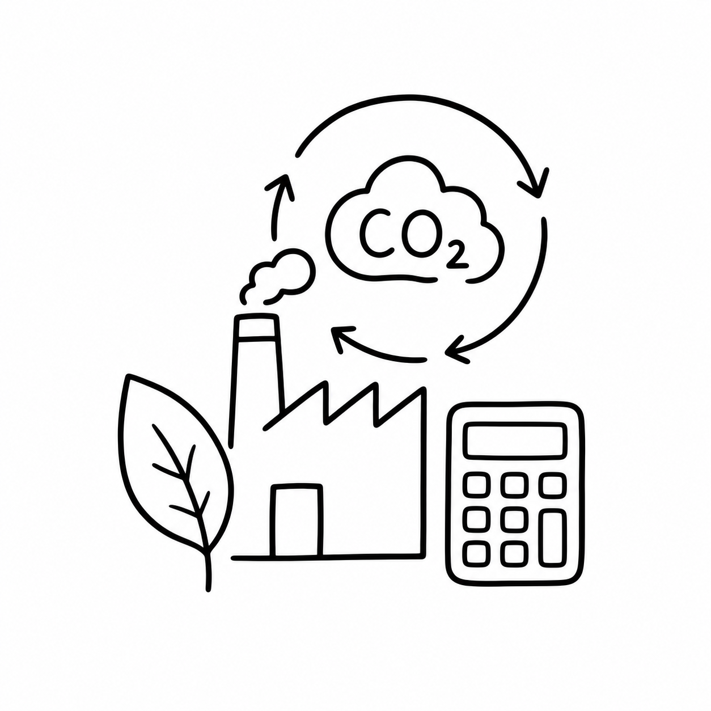
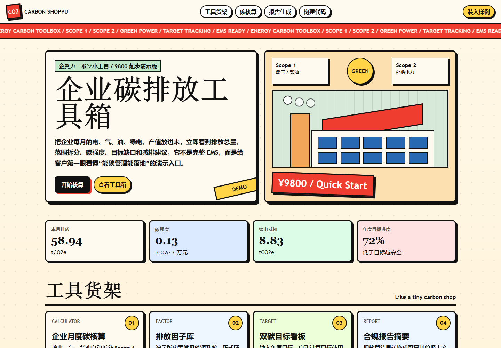
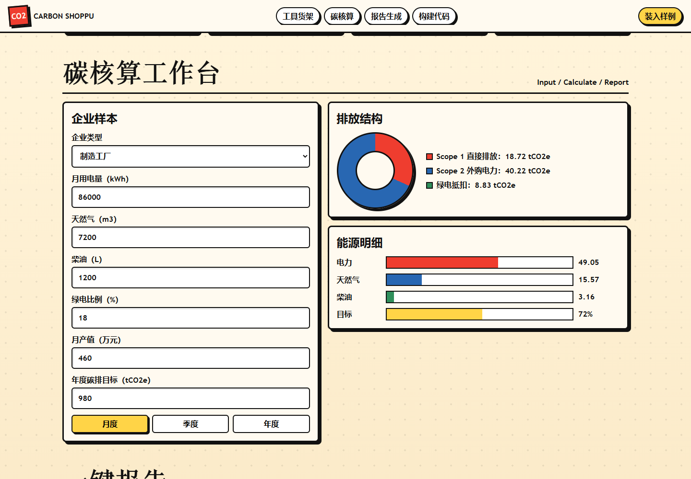
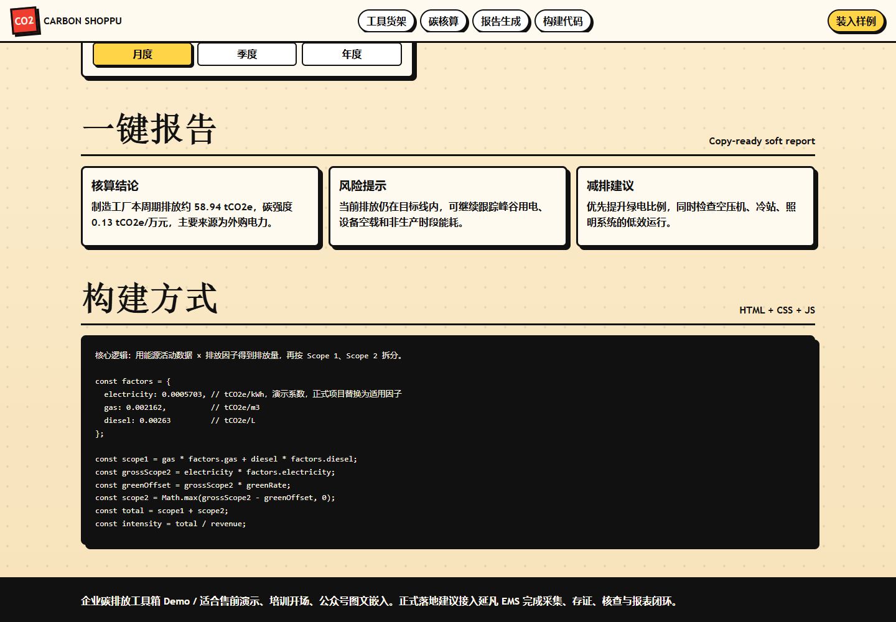

# 企业碳排放工具箱

<p align="center">
  
</p>

一个可直接运行的企业碳排放单页演示项目。它把企业每月电力、天然气、柴油、绿电比例、月产值和年度目标转成可视化碳排结果，并自动生成 Scope 1 / Scope 2 拆分、目标进度、风险提示和减排建议。

页面采用复古电商目录式视觉：奶油底色、黑色粗描边、红色价格贴纸、商品货架式工具卡片和横向滚动公告。项目不依赖构建工具，入口就是 `index.html`，适合售前演示、培训开场、公众号图文嵌入和轻量原型验证。

## 在线预览截图

### 首页与 KPI



### 碳核算工作台



### 一键报告与构建方式



## 功能清单

- 企业类型选择：制造工厂、产业园区、商业楼宇。
- 活动数据录入：月用电量、天然气、柴油、绿电比例、月产值、年度碳排目标。
- 核算口径切换：月度、季度、年度。
- Scope 1 核算：天然气和柴油直接排放。
- Scope 2 核算：外购电力间接排放，支持绿电比例抵扣演示。
- KPI 看板：本期排放、碳强度、绿电抵扣、年度目标进度。
- 可视化图表：排放结构环形图、能源排放柱状图、目标进度条。
- 报告文案：自动输出核算结论、风险提示和减排建议。
- 样例数据：点击“装入样例”快速恢复演示数据。

## 快速运行

使用 npm 脚本：

```powershell
npm start
```

然后访问：

```text
http://127.0.0.1:5173/
```

也可以直接使用 Python 静态服务：

```powershell
python -m http.server 5173 --bind 127.0.0.1
```

页面没有外部运行时依赖，也可以直接双击打开 `index.html`。

## 项目结构

```text
carbon-calculator/
  index.html
  package.json
  README.md
  docs/
    design-and-drawing.md
    images/
      project-icon.png
      screenshot-home.png
      screenshot-calculator.png
      screenshot-report.png
    prompts/
      project-icon.md
```

## 核算模型

演示版内置排放因子如下：

```js
const factors = {
  electricity: 0.0005703, // tCO2e/kWh
  gas: 0.002162,          // tCO2e/m3
  diesel: 0.00263         // tCO2e/L
};
```

计算逻辑：

```text
电力排放 grossScope2 = 用电量 * 电力排放因子
绿电抵扣 greenOffset = grossScope2 * 绿电比例
Scope 2 = max(grossScope2 - greenOffset, 0)
Scope 1 = 天然气 * 天然气因子 + 柴油 * 柴油因子
总排放 = Scope 1 + Scope 2
碳强度 = 总排放 / 月产值
目标进度 = 总排放 * 12 / 年度碳排目标
```

## 图标与截图生成

项目图标位于 `docs/images/project-icon.png`，由 Banana API 的 `gpt-image-2` 模型按 `docs/prompts/project-icon.md` 提示词生成。图标要求为白色背景、黑色线条、简单简笔画风格。

README 中的页面截图来自本地服务 `http://127.0.0.1:5173/`，使用浏览器自动化分别截取首页、核算工作台和报告区域。

## 适用边界

这是一个演示型碳核算工具，不应直接作为政府申报、第三方核查或正式碳盘查报告的唯一依据。正式落地时应根据企业组织边界、运营边界、能源凭证、核算周期、地方政策和适用标准替换排放因子、数据采集方式与报表格式。

## 设计说明

完整设计与绘制说明见 [docs/design-and-drawing.md](docs/design-and-drawing.md)。
