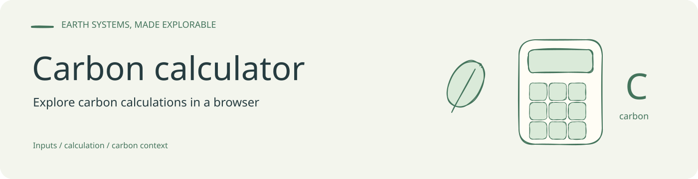

<!-- readme-visual-refresh:banner -->

<!-- /readme-visual-refresh:banner -->

# Carbon Calculator Kit

<p align="center">
  
</p>

<p align="center">
  <strong>企业碳排放工具箱：一个零构建依赖的 Scope 1 / Scope 2 单页演示应用</strong>
</p>

<p align="center">
  <a href="https://github.com/GISWLH/carbon-calculator-kit"></a>
  
  
  
</p>

> **工具调用情况**：图标由 Banana API / POE `gpt-image-2` 生成；页面截图由本地静态服务 + Playwright/Chrome 截取；项目已通过 `npm start` 方式启动验证；代码已推送到 `git@github.com:GISWLH/carbon-calculator-kit.git`。

## Overview

Carbon Calculator Kit 是一个可直接打开或通过静态服务运行的企业碳排放核算演示项目。它把企业每月电力、天然气、柴油、绿电比例、月产值和年度碳排目标转成可视化结果，并自动输出 Scope 1 / Scope 2 拆分、目标进度、风险提示和减排建议。

项目采用复古电商目录式视觉：奶油底色、黑色粗描边、红色价格贴纸、商品货架式工具卡片和横向滚动公告。它适合售前演示、培训开场、公众号图文嵌入、低成本原型验证，以及向客户解释“碳数据如何从活动数据走向看板和报告”。

## Screenshots

### Home / KPI


### Calculator


### Report


## Features

- 企业类型选择：制造工厂、产业园区、商业楼宇。
- 活动数据录入：月用电量、天然气、柴油、绿电比例、月产值、年度碳排目标。
- 核算口径切换：月度、季度、年度。
- Scope 1 核算：天然气和柴油直接排放。
- Scope 2 核算：外购电力间接排放，支持绿电比例抵扣演示。
- KPI 看板：本期排放、碳强度、绿电抵扣、年度目标进度。
- 可视化图表：排放结构环形图、能源排放柱状图、目标进度条。
- 报告文案：自动输出核算结论、风险提示和减排建议。
- 样例数据：点击“装入样例”快速恢复演示数据。
- 零构建依赖：不需要 Vite、Webpack 或后端服务。

## Quick Start

使用 npm 脚本启动本地静态服务：

```powershell
npm start
```

访问：

```text
http://127.0.0.1:5173/
```

也可以直接使用 Python：

```powershell
python -m http.server 5173 --bind 127.0.0.1
```

页面没有外部运行时依赖，直接双击打开 `index.html` 也可以运行。

## Tech Stack

- `HTML`：单页结构与业务表单。
- `CSS`：复古目录式视觉、响应式布局、图表样式。
- `JavaScript`：活动数据读取、排放计算、KPI 更新、报告文本生成。
- `Python http.server`：本地静态服务，仅用于预览。
- `Banana API / POE gpt-image-2`：生成 README 和页面 favicon 使用的项目图标。
- `Playwright / Chrome`：生成 README 页面截图。

## Project Structure

```text
carbon-calculator-kit/
  index.html
  package.json
  README.md
  docs/
    design-and-drawing.md
    images/
      project-icon.png
      screenshot-home.png
      screenshot-calculator.png
      screenshot-report.png
    prompts/
      project-icon.md
```

## Calculation Model

演示版内置排放因子：

```js
const factors = {
  electricity: 0.0005703, // tCO2e/kWh
  gas: 0.002162,          // tCO2e/m3
  diesel: 0.00263         // tCO2e/L
};
```

计算逻辑：

```text
电力排放 grossScope2 = 用电量 * 电力排放因子
绿电抵扣 greenOffset = grossScope2 * 绿电比例
Scope 2 = max(grossScope2 - greenOffset, 0)
Scope 1 = 天然气 * 天然气因子 + 柴油 * 柴油因子
总排放 = Scope 1 + Scope 2
碳强度 = 总排放 / 月产值
目标进度 = 总排放 * 12 / 年度碳排目标
```

## Generated Assets

| Asset | Tool | Source | Output |
| --- | --- | --- | --- |
| 项目图标 | Banana API / POE `gpt-image-2` | `docs/prompts/project-icon.md` | `docs/images/project-icon.png` |
| 首页截图 | Playwright + Chrome | `http://127.0.0.1:5173/` | `docs/images/screenshot-home.png` |
| 核算工作台截图 | Playwright + Chrome | `http://127.0.0.1:5173/#calculator` | `docs/images/screenshot-calculator.png` |
| 报告截图 | Playwright + Chrome | `http://127.0.0.1:5173/#report` | `docs/images/screenshot-report.png` |

## Validation

当前验收记录：

- README 已按常见项目结构整理。
- 项目图标为白底黑线简笔画风格。
- 本地静态服务访问返回 `200`。
- README 已嵌入三张页面截图。
- GitHub 远程目标：`git@github.com:GISWLH/carbon-calculator-kit.git`。

## Notes

这是一个演示型碳核算工具，不应直接作为政府申报、第三方核查或正式碳盘查报告的唯一依据。正式落地时应根据企业组织边界、运营边界、能源凭证、核算周期、地方政策和适用标准替换排放因子、数据采集方式与报表格式。

完整设计与绘制说明见 [docs/design-and-drawing.md](docs/design-and-drawing.md)。

<!-- readme-visual-refresh:artwork-source -->
[Editable banner artwork · Excalidraw](assets/readme/banner.excalidraw)
<!-- /readme-visual-refresh:artwork-source -->
